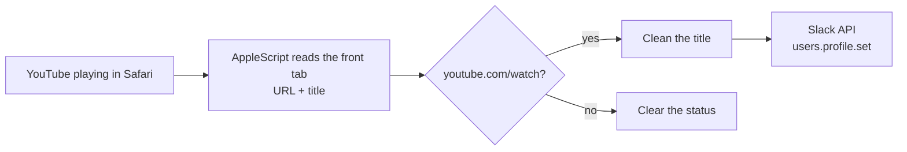

# Slack now playing

Shows the YouTube song I'm listening to as my Slack status, the way MSN Messenger used to show what you were playing.

> 🎧 🎶 Selena Gomez - Hands To Myself (Official Audio)

## Why

I wanted that old MSN Messenger effect back: your status quietly showing what you were listening to. A tiny detail that always felt human and personal, a simple way to show a bit of who you are.

Updating it by hand takes 30 seconds. Automating it took about 30 minutes. Not the most rational use of time, but every time I hit a wall my first thought is: *there must be a way.*

## How it works

No extra software: AppleScript and `curl` both ship with macOS, plus a small Slack app with one permission.

## What didn't work first

- **Arc, my work browser.** Arc only exposes the active tab to AppleScript. Scanning all tabs failed on every one of my 167 tabs with a "can't make «class» into type specifier" error, and reading the active tab breaks the moment I switch tabs, which my job requires all day (email, Kajabi, Drive).
- **Picture-in-Picture.** Looks nice, but exposes nothing a script can read.
- **A multi-line `curl` inside `do shell script`.** It ran without errors and silently sent nothing. Putting the command on one line fixed it.

Adding `log` lines at every step (Script Editor > View > Show Log) is what turned "it runs but nothing happens" into a clear answer.

**The fix was architecture, not code:** Arc for work, Safari for music. Safari's AppleScript support is solid and it doesn't need to be in focus.

## Setup

1. **Create a Slack app:** api.slack.com/apps > Create New App > From scratch.
2. **Add the permission:** OAuth & Permissions > *User Token Scopes* (not Bot) > add `users.profile:write`.
3. **Install it** to your workspace and copy the **User OAuth Token** (`xoxp-...`).
4. Open **Script Editor**, paste a script and replace `PASTE_YOUR_XOXP_TOKEN_HERE` with your token.
5. Play a YouTube video in Safari and click **Run**. Allow the access prompts the first time.

Two versions:

- [`now-playing.applescript`](now-playing.applescript): runs once, with a log line for every step. Good for testing.
- [`now-playing-loop.applescript`](now-playing-loop.applescript): checks every 60 seconds, only updates when the song changes and clears the status when YouTube closes. Save it as an app with Automator (New > Application > Run AppleScript) to keep it running in the background.

## Keep your token private

The token can edit your Slack profile. Never paste it into a chat, a doc or a commit. If it leaks: OAuth & Permissions > **Revoke All OAuth Tokens**, then reinstall the app to get a new one.

## Known limits

- Reads Safari's front tab only. Music in another Safari tab isn't picked up.
- A title with an apostrophe or double quotes can break the request, because the title goes straight into the shell command.
